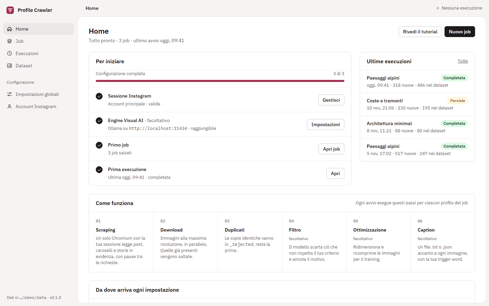
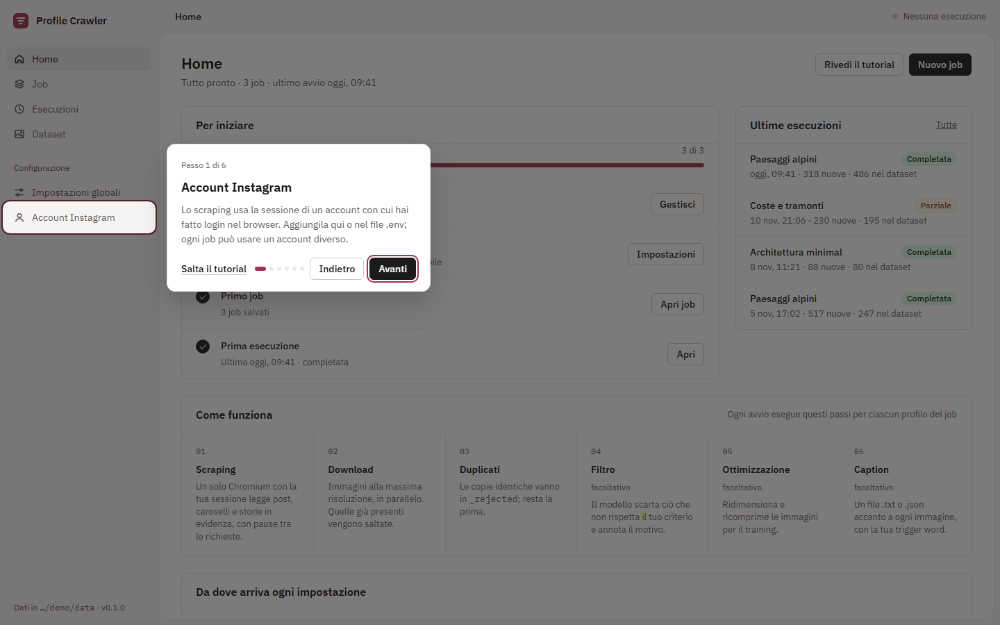
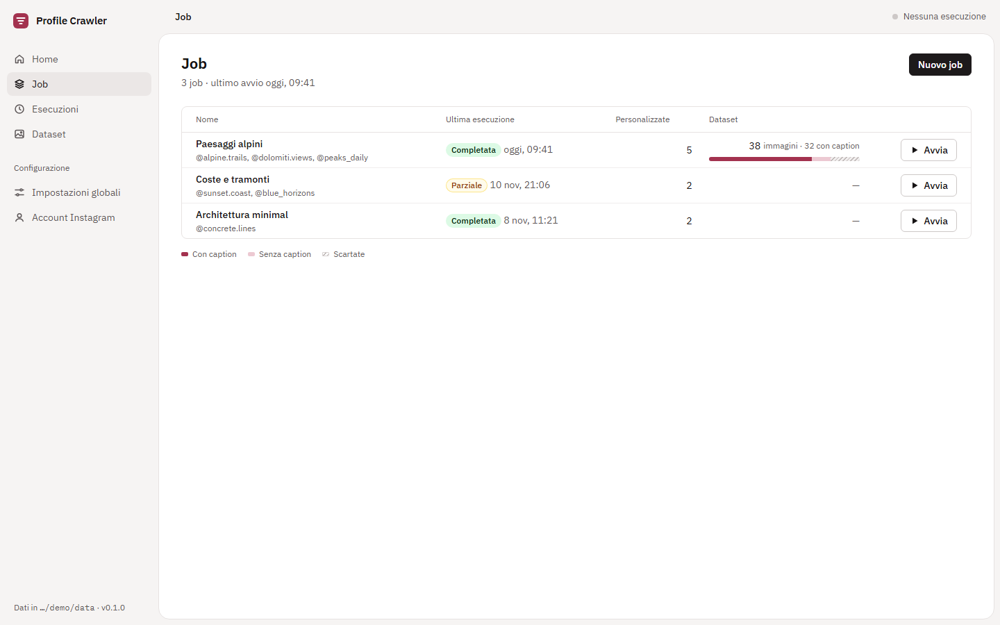
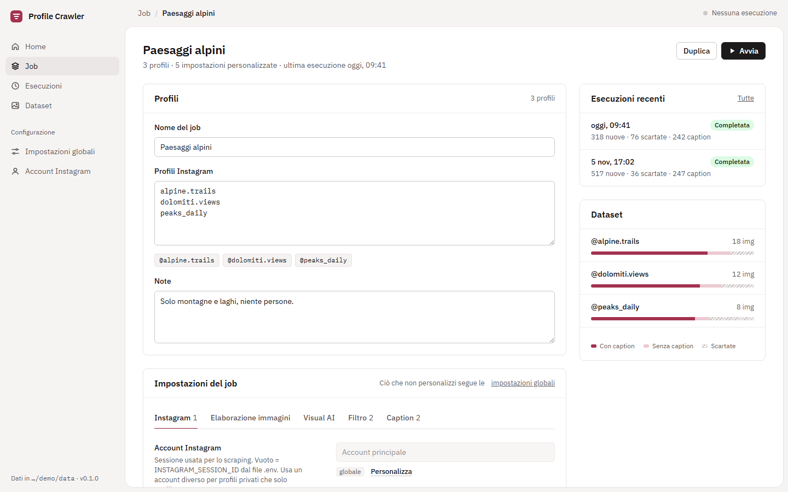
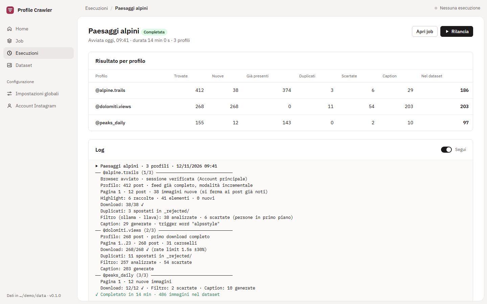
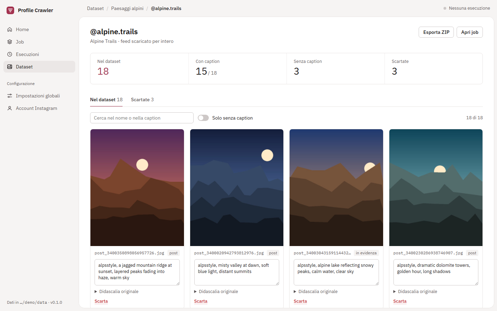
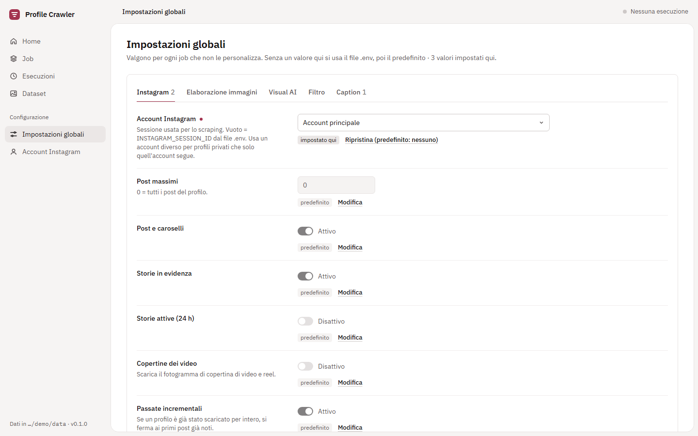
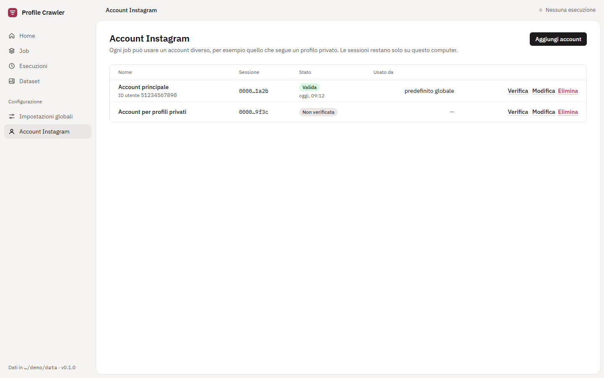

<div align="center">

# 📸 InstagramProfileCrawler

### From Instagram profile to LoRA-ready dataset, in one click.

Scrape posts, carousels and highlights, drop duplicates, let a **local** vision model filter and caption every image,
then review everything in a clean web GUI and export a ZIP ready for training.




[Features](#-features) · [Quick start](#-quick-start) · [Web GUI](#%EF%B8%8F-web-gui) · [CLI](#-command-line) · [Configuration](#%EF%B8%8F-configuration) · [How it works](#-how-scraping-works)

</div>

---

## ✨ Features

<table>
<tr>
<td width="50%" valign="top">

**📥 Scraping that doesn't get you blocked**
- Posts, carousels, story highlights, current stories and video covers
- One real Chromium per run: every call carries the browser's cookies and fingerprint
- Paced requests with jitter, exponential back-off on 429, host fallback
- Incremental runs: stops at the first posts it already knows

</td>
<td width="50%" valign="top">

**🤖 Local Visual AI, no cloud**
- Filter images with a plain-language rule (*"keep only landscapes, exclude people"*)
- Automatic captions with your trigger word
- `.txt` sidecars (kohya, ai-toolkit), `.json`, or prompt/negative pairs
- Works with **Ollama**, **llama.cpp** (`llama-server`) and **Strata**

</td>
</tr>
<tr>
<td width="50%" valign="top">

**🖥️ A real GUI, not just a script**
- Jobs you can re-run any time, a run queue with live log and progress
- Several Instagram accounts (e.g. one that follows a private profile)
- Every setting shows where its value comes from

</td>
<td width="50%" valign="top">

**🗂️ A dataset you can trust**
- Gallery per profile: edit captions, reject or restore images
- Nothing is ever deleted: rejects go to `_rejected/` with the reason
- Exact-duplicate removal and image optimization for training
- One-click ZIP export

</td>
</tr>
</table>

## 🚀 Quick start

```bash
git clone https://github.com/KorinBlack/InstagramProfileCrawler.git
cd InstagramProfileCrawler

python -m venv venv
venv\Scripts\Activate.ps1        # Windows
source venv/bin/activate         # Linux / macOS

pip install -e ".[dev]"
python -m playwright install chromium

cp .env.example .env             # add your INSTAGRAM_SESSION_ID (or add the account from the GUI)

instagram-crawler gui            # open the web GUI on http://127.0.0.1:8765
```

Prefer the terminal? `instagram-crawler some.profile` does the whole pipeline for one profile.

> **Requirements:** Python 3.10+. For filtering and captions, a local vision model served by
> [Ollama](https://ollama.com), llama.cpp (`llama-server` with `--mmproj`) or Strata.

## 🖥️ Web GUI

```bash
instagram-crawler gui          # or: python -m src.web
```

The interface (in Italian) opens on `http://127.0.0.1:8765`. On first start a short animated tour shows where everything is.

<p align="center">
  
</p>

### Jobs: a list of profiles plus only the settings you want different

Every setting is inherited from the global ones until you *customize* it, and the GUI shows where each value comes from
(job, global, `.env`, default). Re-run a job any time without setting anything up again.

<p align="center">
  
  
</p>

### Runs: one at a time, live, stoppable

A queue that runs one job at a time, with live log, progress, per-profile results and the exact configuration used.

<p align="center">
  
</p>

### Dataset: review before you train

A gallery per profile: edit captions inline, reject or restore images, show only uncaptioned ones, export a ZIP ready for training.

<p align="center">
  
</p>

### Global settings and Instagram accounts

<p align="center">
  
  
</p>

System prompt, filter and caption prompts, the trigger word and each engine's API key can be set globally or per job.

> 🔒 **Privacy by design.** The server listens on `127.0.0.1` only, because it holds Instagram sessions. Sessions and API keys
> are never sent back to the browser (only the last 4 characters are shown). GUI data (jobs, accounts, logs) lives in `data/`,
> which is git-ignored.

## ⌨️ Command line

```bash
instagram-crawler username                          # one profile
instagram-crawler username --max-posts 0 --stories  # all posts + current stories
instagram-crawler username --generate-captions --engine strata
instagram-crawler username --filter --all           # re-filter the whole dataset
instagram-crawler --batch batch.txt                 # several profiles, one browser
instagram-crawler --job "Alpine landscapes"         # a job saved in the GUI
instagram-crawler username -v                       # print resolved settings and their source
```

| Option | Meaning |
|---|---|
| `--max-posts N` | Maximum posts (0 = all) |
| `--output DIR` | Dataset folder (one subfolder per profile) |
| `--stories` / `--no-highlights` | Include current stories / skip highlights |
| `--full` | Ignore incremental mode and page through every post |
| `--all` | Filter/optimize/caption the whole dataset, not only new images |
| `--deduplicate`, `--optimize`, `--filter`, `--generate-captions` | Processing steps |
| `--caption-format text\|json\|pairs` | `.txt` sidecar (kohya, ai-toolkit), `.json`, or `.json` with a negative prompt |
| `--engine ollama\|llama.cpp\|strata` | Visual AI engine |
| `--account ID` | Account saved in the GUI |
| `--job NAME` | Run a job saved in the GUI |
| `--show-browser` | Show the Chromium window |

## ⚙️ Configuration

Values are resolved in this order:

```
job  →  global settings (GUI)  →  .env  →  built-in default
```

On the command line, flags win over everything.

<details>
<summary><b>.env reference</b></summary>

```env
INSTAGRAM_SESSION_ID=your_session_id_here

# Visual AI engine: ollama, llama.cpp or strata
VISUAL_AI_TYPE=ollama
VISUAL_AI_OLLAMA_HOST=http://localhost:11434
VISUAL_AI_OLLAMA_MODEL=llava
VISUAL_AI_LLAMA_HOST=http://localhost:8080
VISUAL_AI_LLAMA_MODEL=gemma4
VISUAL_AI_STRATA_HOST=http://127.0.0.1:8080
VISUAL_AI_STRATA_MODEL=qwen3.8-flash-next
# Optional API keys, sent as "Authorization: Bearer <key>"
VISUAL_AI_OLLAMA_API_KEY=
VISUAL_AI_LLAMA_API_KEY=
VISUAL_AI_STRATA_API_KEY=

OUTPUT_DIR=./dataset
RATE_LIMIT_DELAY=1.5
IMAGE_QUALITY=95

GENERATE_CAPTIONS=true
FILTERING_ENABLED=true
MIN_CONFIDENCE=0.7
FILTERING_PROMPT="Keep only landscapes, exclude people."
```

</details>

<details>
<summary><b>Where do I find my session ID?</b></summary>

Log in to instagram.com in your browser, open the developer tools → *Application* (Chrome) or *Storage* (Firefox) →
*Cookies* → `https://www.instagram.com`, and copy the value of `sessionid`. Paste it in `.env` or in
**Account Instagram → Aggiungi account** in the GUI, then press *Verifica*.

</details>

## 🔍 How scraping works

```
 scrape ─▶ download ─▶ dedupe ─▶ filter (AI) ─▶ optimize ─▶ caption (AI)
```

- **One browser per run.** One Chromium and one page serve every profile of the job. Every API call is a `fetch()` made from
  inside the instagram.com page, so it carries the browser's cookies, headers and TLS fingerprint (requests made outside
  the browser get 429s quickly).
- **Everything, page by page.** All posts (`max_posts` 0 = all), carousels, story highlights (batched API calls, with the
  original HTML parsing kept as a fallback), and optionally current stories and video cover frames.
- **Paced.** Calls are spaced by `rate_limit_delay` with ±30% jitter; on 429 it backs off exponentially, and if one API
  host fails it switches to the other.
- **Cheap repeat runs.** Files are named by media id, so images already on disk are skipped. Once a profile has been
  downloaded in full, later runs stop paging at the first known posts.
- **Nothing is deleted.** Duplicates and filtered images move to `<profile>/_rejected/` with the reason in `reasons.json`.

### Output

```
dataset/
└── some.profile/
    ├── post_3400356513426495358.jpg
    ├── post_3400356513426495358.txt     # caption sidecar
    ├── ...
    ├── manifest.json                    # original IG captions, sources, feed state
    └── _rejected/
        ├── post_3500000000000000001.jpg
        └── reasons.json                 # why each image was rejected
```

| Format | File | Content |
|---|---|---|
| `text` | `post_<id>.txt` | the caption (trigger word prepended if set) |
| `json` | `post_<id>.json` | `{"image", "caption", "tags", "timestamp"}` |
| `pairs` | `post_<id>.json` | `{"image", "prompt", "negative_prompt", "timestamp"}` |

## 🧠 Visual AI engines

| Engine | Models | Notes |
|---|---|---|
| **Ollama** | `llava`, `bakllava`, any vision model you pull | Easiest setup |
| **llama.cpp** | any GGUF vision model (LLaVA, Gemma, Qwen-VL…) | Run `llama-server` with `--mmproj` for the projector file |
| **Strata** | Qwen3.8 (OpenAI-compatible) | Default `http://127.0.0.1:8080/v1`, same port as llama.cpp: don't run both |

`<think>` blocks from reasoning models are stripped before the response is parsed.

## 🗺️ Project structure

```
src/
├── cli.py              # command-line interface
├── pipeline.py         # scrape → download → dedupe → filter → optimize → caption
├── settings.py         # setting schema and job → global → .env → default resolution
├── store.py            # jobs, runs, accounts (JSON files under data/)
├── instagram/          # Playwright client, auth, scraper, models
├── images/             # downloader, optimizer, deduplicator
├── filtering/          # Visual AI engines (Ollama, llama.cpp, Strata)
├── web/                # FastAPI app, run queue, static frontend (no build step)
├── config/             # .env and YAML config
└── utils/              # logging, retry, stats
```

## 🛠️ Development

```bash
pip install -e ".[dev]"
pytest                    # tests
black src/ tests/         # format
ruff check src/ tests/    # lint
mypy src/                 # type check
```

## 🧭 Roadmap

- [x] Multi-profile batch processing
- [x] Web UI dashboard
- [x] Real-time progress visualization
- [ ] Support for Instagram Reels
- [ ] Advanced image cropping and composition
- [ ] Dataset validation tools

## 🤝 Contributing

Contributions are welcome! Fork the project, create a feature branch, and open a Pull Request.
Bugs and ideas go in the [issues](https://github.com/KorinBlack/InstagramProfileCrawler/issues).

## ⚠️ Responsible use

Only download content you have the right to use, respect Instagram's Terms of Service and the privacy of the people in
the pictures. This tool is meant for personal research and for building datasets from content you own or are allowed to use.

## 📄 License

MIT.

## 🙏 Acknowledgments

[Playwright](https://playwright.dev/) · [Ollama](https://ollama.com) · [llama.cpp](https://github.com/ggml-org/llama.cpp) ·
[FastAPI](https://fastapi.tiangolo.com/) · [Pillow](https://pillow.readthedocs.io/) · [Rich](https://rich.readthedocs.io/)

<div align="center"><sub>Made with ❤️ for AI researchers and creators. Screenshots use demo data and generated placeholder images.</sub></div>
